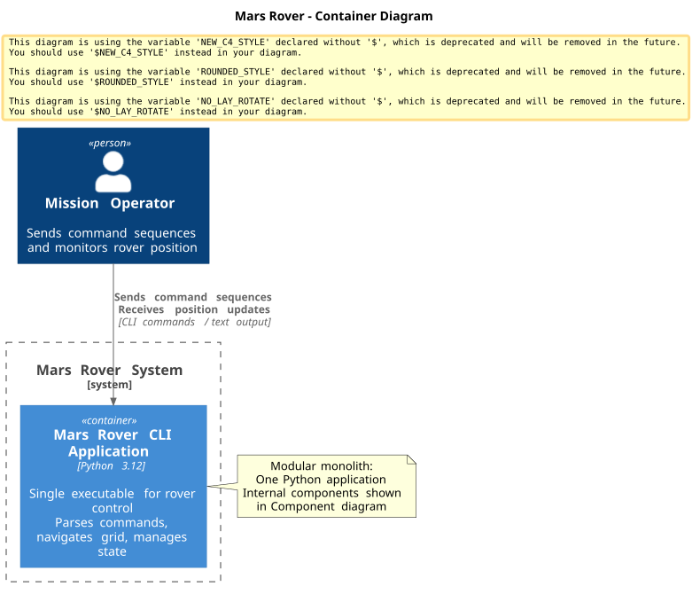
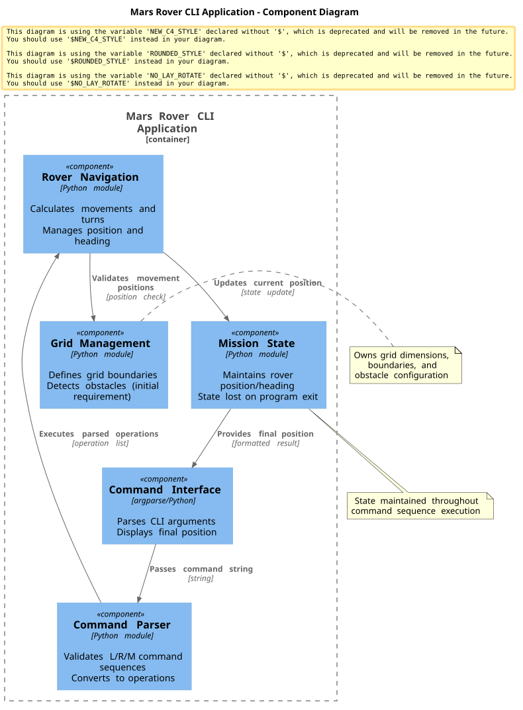

# 5. Building Block View

## 5.1 Overview

The Mars Rover system is implemented as a **single executable Python CLI application** following a modular monolith pattern. This chapter describes the system's building blocks at the container and component levels, showing the responsibilities, interfaces, and relationships between internal modules.

### 5.1.1 Key Architectural Principles
- **Single Executable**: One Python 3.12 application containing all functionality
- **Modular Decomposition**: Internal components with clear separation of concerns
- **In-Memory State**: Rover state maintained during command sequence execution
- **Pure Domain Logic**: Navigation logic isolated for testability
- **CLI-First Interface**: Primary interaction via command-line arguments

## 5.2 Container View

The system consists of exactly one container: the **Mars Rover CLI Application**. This container represents the complete executable software system that interacts with the Mission Operator.

### 5.2.1 Container Diagram

```plantuml
@startuml c4-container
!include https://raw.githubusercontent.com/plantuml-stdlib/C4-PlantUML/master/C4_Container.puml

title Mars Rover - Container Diagram

Person(operator, "Mission Operator", "Sends command sequences and monitors rover position")

System_Boundary(mars_rover, "Mars Rover System") {
    Container(cli_app, "Mars Rover CLI Application", "Python 3.12", "Single executable for rover control\nParses commands, navigates grid, manages state")
}

Rel(operator, cli_app, "Sends command sequences\nReceives position updates", "CLI commands / text output")

note right of cli_app
Modular monolith:
One Python application
Internal components shown
in Component diagram
end note

@enduml
```

*Diagram file: [./diagrams/c4-container.puml](./diagrams/c4-container.puml)*



### 5.2.2 Container Responsibilities

| Container | Technology | Responsibilities |
|-----------|------------|------------------|
| **Mars Rover CLI Application** | Python 3.12 | • Single entry point for all rover functionality<br>• Command-line interface using `argparse`<br>• Internal coordination of five components<br>• Text-based output formatting |

## 5.3 Component View

The CLI application contains five internal components that implement the rover functionality. These components are organized as Python modules within the single executable application.

### 5.3.1 Component Diagram

```plantuml
@startuml c4-component-cli
!include https://raw.githubusercontent.com/plantuml-stdlib/C4-PlantUML/master/C4_Component.puml

title Mars Rover CLI Application - Component Diagram

Container_Boundary(cli_app, "Mars Rover CLI Application") {
    Component(command_interface, "Command Interface", "argparse/Python", "Parses CLI arguments\nDisplays final position")
    Component(command_parser, "Command Parser", "Python module", "Validates L/R/M command sequences\nConverts to operations")
    Component(rover_navigation, "Rover Navigation", "Python module", "Calculates movements and turns\nManages position and heading")
    Component(grid_management, "Grid Management", "Python module", "Defines grid boundaries\nDetects obstacles (initial requirement)")
    Component(mission_state, "Mission State", "Python module", "Maintains rover position/heading\nState lost on program exit")
}

Rel(command_interface, command_parser, "Passes command string", "string")
Rel(command_parser, rover_navigation, "Executes parsed operations", "operation list")
Rel(rover_navigation, grid_management, "Validates movement positions", "position check")
Rel(rover_navigation, mission_state, "Updates current position", "state update")
Rel(mission_state, command_interface, "Provides final position", "formatted result")

note bottom of mission_state
State maintained throughout
command sequence execution
end note

note right of grid_management
Owns grid dimensions,
boundaries, and
obstacle configuration
end note

@enduml
```

*Diagram file: [./diagrams/c4-component-cli.puml](./diagrams/c4-component-cli.puml)*



### 5.3.2 Component Descriptions

#### 5.3.2.1 Command Interface Component
- **Purpose**: Primary user interaction point via command-line
- **Responsibilities**:
  - Parse command-line arguments using Python's `argparse` module
  - Validate basic input format (command sequence, starting position, grid size)
  - Display formatted final position to user
  - Handle CLI-level error reporting (argument parsing errors)
- **Interfaces**:
  - **Input**: Command-line arguments: `--commands "LMLMLMLMM" --position "1 2 N" --grid "5 5"`
  - **Output**: Formatted text: `"Final position: 1 3 N"` or error messages
  - **Internal**: Calls Command Parser with command string
- **Dependencies**: Standard Python library (`argparse`, `sys`)

#### 5.3.2.2 Command Parser Component
- **Purpose**: Validate and convert command sequences to operations
- **Responsibilities**:
  - Validate command strings contain only valid characters (L, R, M)
  - Convert character sequences to internal operation representations
  - Detect and report command syntax errors
  - Provide clear error messages for invalid command sequences
- **Interfaces**:
  - **Input**: Command string (e.g., `"LMLMLMLMM"`)
  - **Output**: List of operation objects ready for execution
  - **Internal**: Called by Command Interface, provides operations to Rover Navigation
- **Dependencies**: None (pure validation and conversion)

#### 5.3.2.3 Rover Navigation Component
- **Purpose**: Core movement and positioning logic
- **Responsibilities**:
  - Execute operations from Command Parser (move forward, turn left/right)
  - Calculate new positions based on current heading
  - Manage heading orientation changes (90-degree rotations)
  - Coordinate movement validation with Grid Management
  - Update Mission State with position and heading changes
- **Interfaces**:
  - **Input**: List of operations from Command Parser
  - **Output**: Updated position and heading (via Mission State updates)
  - **Internal**: Calls Grid Management for position validation, updates Mission State
- **Dependencies**: Grid Management (for movement validation), Mission State (for position updates)

#### 5.3.2.4 Grid Management Component
- **Purpose**: Define and enforce spatial constraints
- **Responsibilities**:
  - Define grid dimensions (width, height)
  - Validate positions are within grid boundaries (per requirements)
  - Detect obstacles and prevent movement into blocked cells (per requirements)
  - Store obstacle configuration (initial positions)
  - Generate clear error messages for boundary/obstacle violations
- **Interfaces**:
  - **Input**: Position coordinates for validation
  - **Output**: Validation result (allowed/blocked with reason)
  - **Internal**: Called by Rover Navigation during movement validation
- **Dependencies**: None (owns grid configuration and obstacle data)

#### 5.3.2.5 Mission State Component
- **Purpose**: Maintain rover state during command execution
- **Responsibilities**:
  - Store current rover position and heading in memory
  - Provide current state to Command Interface for display
  - Support position updates from Rover Navigation
  - Maintain state throughout command sequence processing
  - No persistence between separate program invocations
- **Interfaces**:
  - **Input**: Position/heading updates from Rover Navigation
  - **Output**: Current position/heading for Command Interface display
  - **Internal**: Updated by Rover Navigation, queried by Command Interface
- **Dependencies**: None (self-contained state management)

## 5.4 Component Relationships

### 5.4.1 Interaction Flow
```
Command Interface → Command Parser → Rover Navigation
                                    ↙             ↘
                          Grid Management     Mission State
                                    ↖             ↙
                                    Command Interface
```

### 5.4.2 Relationship Rules
1. **Linear Processing Flow**: Command Interface → Command Parser → Rover Navigation
2. **Validation Coordination**: Rover Navigation consults Grid Management for movement validation
3. **State Management**: Rover Navigation updates Mission State; Command Interface reads final state
4. **No Grid-State Dependency**: Grid Management owns obstacle configuration independently
5. **Simple Dependencies**: Each component has minimal, well-defined dependencies

## 5.5 Interfaces and Contracts

### 5.5.1 External Interface (CLI)
```python
# Command format
python mars_rover/cli/main.py --commands "LMLMLMLMM" --position "1 2 N" --grid "5 5"

# Response format (success)
"Final position: 1 3 N"

# Response format (errors)
"Error: Invalid command 'X' in sequence"
"Error: Movement blocked by obstacle at (2, 3)"
"Error: Position (6, 2) outside grid bounds (5x5)"
```

### 5.5.2 Internal Component Interfaces

#### Command Interface → Command Parser
```python
def parse_command_string(commands: str) -> List[Operation]:
    """Validate command string and convert to operation list"""
    # Input: "LMLMLMLMM"
    # Output: [TurnLeft(), MoveForward(), TurnLeft(), ...]
```

#### Command Parser → Rover Navigation
```python
def execute_operations(operations: List[Operation]) -> Tuple[Position, Heading]:
    """Execute operation sequence and return final position"""
    # Processes: TurnLeft, TurnRight, MoveForward
    # Validates movements with Grid Management
    # Updates Mission State after each operation
```

#### Rover Navigation → Grid Management
```python
def can_move_to(position: Position, heading: Heading) -> Tuple[bool, Optional[str]]:
    """Check if movement to position is allowed"""
    # Returns: (True, None) or (False, "Boundary violation"/"Obstacle blocked")
```

#### Rover Navigation → Mission State
```python
def set_current_position(position: Position, heading: Heading) -> None:
    """Update rover's current position and heading"""
    # Called after each valid movement
```

#### Mission State → Command Interface
```python
def get_current_position() -> Tuple[Position, Heading]:
    """Retrieve current rover position for display"""
    # Returns final position after command execution
```

## 5.6 Implementation Details

### 5.6.1 Python Module Structure
```
mars_rover/
├── cli/
│   ├── __init__.py
│   └── main.py              # Command Interface component
├── parser/
│   ├── __init__.py
│   └── command_parser.py    # Command Parser component
├── navigation/
│   ├── __init__.py
│   ├── rover.py            # Rover Navigation component
│   └── movement.py         # Movement calculation helpers
├── grid/
│   ├── __init__.py
│   └── grid.py            # Grid Management component
└── state/
    ├── __init__.py
    └── mission_state.py   # Mission State component
```

### 5.6.2 Key Data Structures
- **Position**: Simple class or tuple `(x, y)` with integer coordinates
- **Heading**: Enumeration `NORTH`, `SOUTH`, `EAST`, `WEST`
- **Operation**: Representations for `TurnLeft`, `TurnRight`, `MoveForward`
- **Grid**: Container for width, height, and obstacle positions
- **RoverState**: Current position and heading (no persistence)

### 5.6.3 State Lifecycle
- **During Execution**: State maintained throughout command sequence processing
- **Between Commands**: Position updated after each valid operation
- **Program Exit**: All state lost; new invocation starts fresh
- **In-Memory Only**: Simple Python objects with no file or database storage

## 5.7 Quality Attribute Support

### 5.7.1 Testability
- **Pure Functions**: Command Parser validation and Grid obstacle detection are pure
- **Isolated Logic**: Components have minimal dependencies for easier testing
- **Clear Interfaces**: Well-defined method signatures support unit testing
- **Predictable Behavior**: Deterministic navigation logic enables comprehensive test coverage

### 5.7.2 Maintainability
- **Single Responsibility**: Each component has focused, well-defined purpose
- **Simple Interfaces**: Minimal, clear method signatures between components
- **Consistent Patterns**: Standard Python conventions and idioms throughout
- **Documented Design**: Clear architecture and component documentation

### 5.7.3 Evolvability
- **Modular Boundaries**: Components can be enhanced independently
- **Stable Interfaces**: Core component interfaces designed for compatibility
- **Extension Points**: Architecture supports planned future features
- **Simple Design**: Avoids over-engineering while supporting evolution

## 5.8 Constraints and Limitations

### 5.8.1 Architecture Constraints (from Chapter 2)
- **Python 3.12 Only**: Implementation limited to Python 3.12 features
- **In-Memory State**: No persistent storage between program invocations
- **CLI Interface**: Primary interaction via command-line arguments
- **Minimal Dependencies**: Core logic uses Python standard library only

### 5.8.2 Implementation Characteristics
- **Single Process**: All components execute within one Python process
- **Sequential Processing**: Commands processed in sequence without parallelism
- **Error Handling**: Invalid commands or blocked movements abort execution
- **Per-Invocation Configuration**: Grid and starting position specified each run

## 5.9 Consistency with Approved Architecture

This building block view implements the architectural decisions established in previous chapters:

### 5.9.1 Alignment with Previous Decisions
- **Chapter 4 Solution Strategy**: Modular decomposition with five components
- **ADR-001**: Python 3.12 implementation with in-memory state management
- **Chapter 3 Context & Scope**: CLI interface with obstacle handling as initial requirement
- **Chapter 2 Constraints**: Python 3.12, minimal dependencies, pytest testing

### 5.9.2 Key Architecture Features Preserved
- **Modular Monolith**: Single executable with internal component boundaries
- **CLI-First Interface**: Command-line interaction via `argparse`
- **In-Memory State**: State maintained during execution, lost on exit
- **Obstacle Handling**: Included as initial requirement (not future extension)
- **Simple Design**: Straightforward component relationships without over-engineering

### 5.9.3 No New Technologies Introduced
- No databases, external services, or cloud infrastructure
- No additional technologies beyond Python 3.12 standard library
- No dependency injection frameworks or complex patterns
- No persistence mechanisms beyond in-memory state

The component structure maintains the approved **modular monolith** pattern: one executable Python application with clearly separated internal components implementing the Mars Rover functionality.

---

*Next: Chapter 6 will describe runtime behavior and sequence diagrams for key scenarios.*
