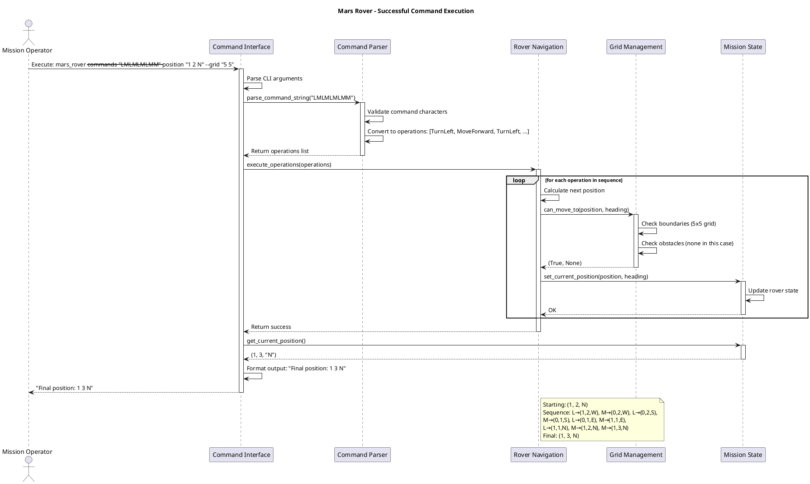
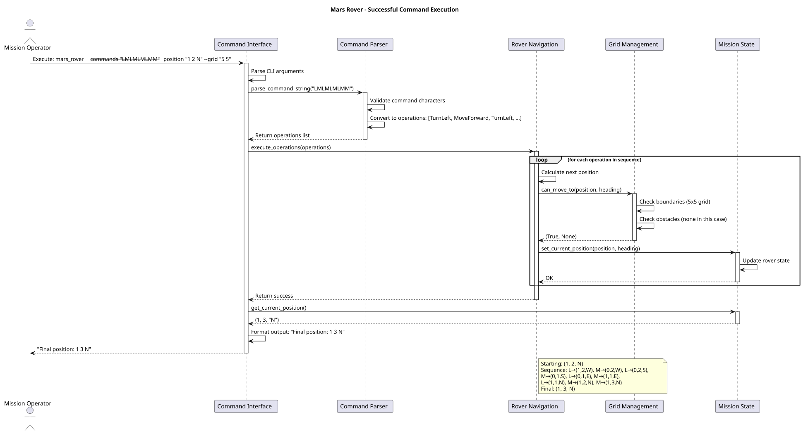
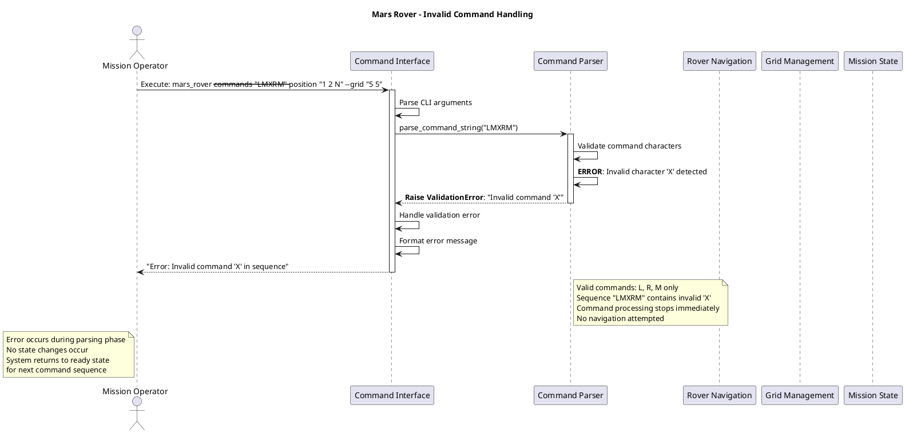
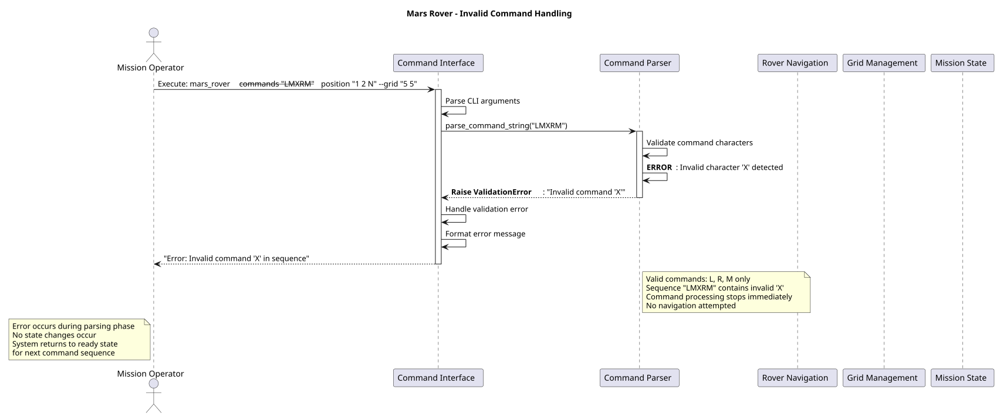
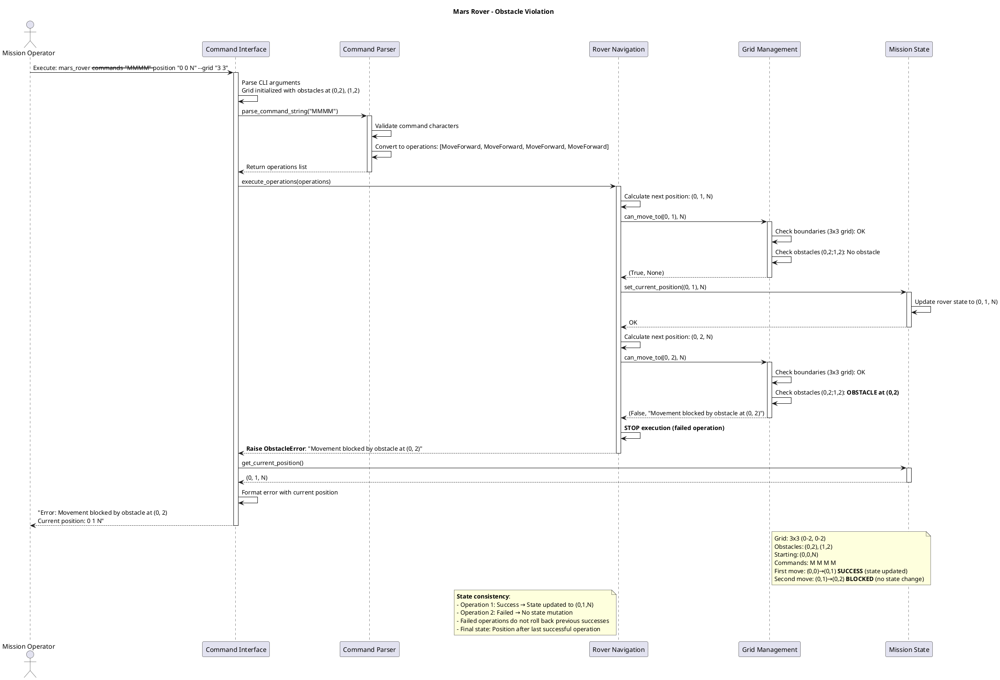
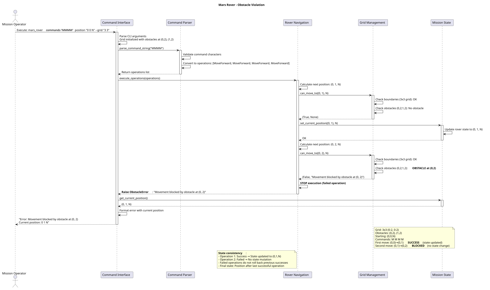
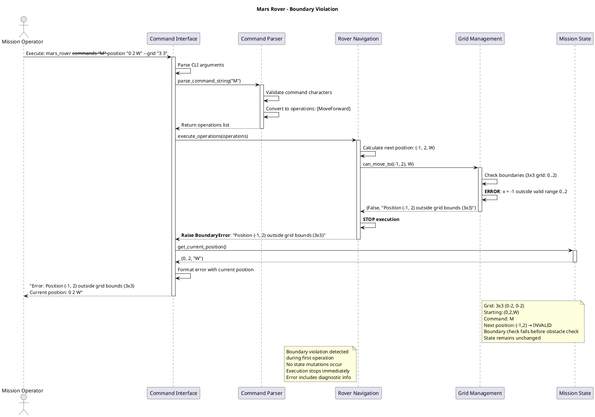
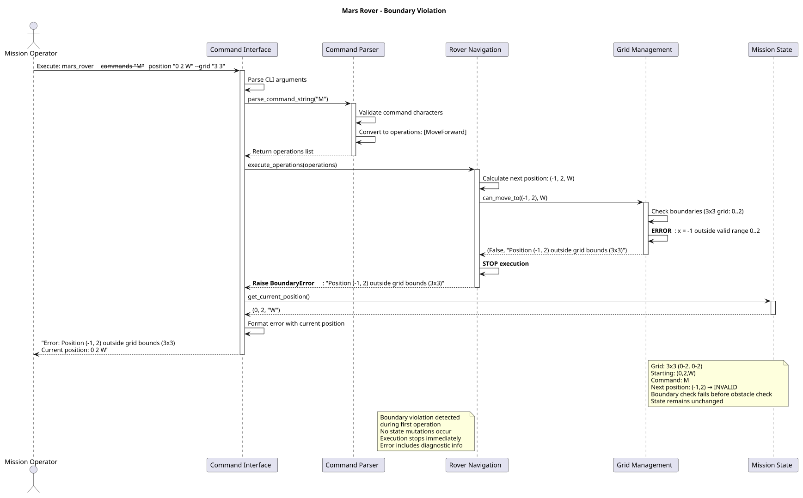

# 6. Runtime View

## 6.1 Overview

The Runtime View describes the dynamic behavior of the Mars Rover system during command execution. This chapter illustrates how the five internal components (Command Interface, Command Parser, Rover Navigation, Grid Management, and Mission State) collaborate to process rover commands, handle errors, and maintain state.

### 6.1.1 Key Runtime Characteristics
- **Sequential Execution**: Commands processed in strict order without parallelism
- **Immediate Error Handling**: Invalid operations abort execution with clear diagnostics
- **State Preservation**: Rover state updated after each valid movement
- **Deterministic Behavior**: Same inputs always produce same outputs
- **Transient Sessions**: Each CLI invocation processes one command sequence independently

## 6.2 Runtime Scenarios

Four primary runtime scenarios demonstrate the system's behavior:

1. **Successful Command Execution** – Normal operation with valid commands
2. **Invalid Command Handling** – Command validation failure
3. **Obstacle Violation** – Movement blocked by obstacle
4. **Boundary Violation** – Movement outside grid boundaries

## 6.3 Successful Command Execution

### 6.3.1 Scenario Description
The Mission Operator sends a valid command sequence (`"LMLMLMLMM"`) starting from position `(1, 2, N)` on a `5×5` grid with no obstacles. The system processes all commands successfully and returns the final position.

### 6.3.2 Sequence Diagram



*Diagram file: [./diagrams/runtime-successful-movement.puml](./diagrams/runtime-successful-movement.puml)*



### 6.3.3 Step-by-Step Analysis

#### Phase 1: Command Parsing and Validation
1. **Command Interface** receives CLI arguments and parses them using `argparse`
2. **Command Parser** validates the command string contains only valid characters (L, R, M)
3. **Command Parser** converts the character sequence to internal operation objects
4. Operations list returned to Command Interface

#### Phase 2: Navigation Execution
5. **Rover Navigation** receives operations list and begins sequential execution
6. For each operation:
   - Calculate next position based on current state
   - Consult **Grid Management** for movement validation
   - **Grid Management** checks boundaries and obstacles
   - If valid: update **Mission State** with new position
   - If invalid: stop execution and raise error

#### Phase 3: Result Reporting
7. After all operations complete successfully, **Rover Navigation** returns success
8. **Command Interface** queries **Mission State** for final position
9. **Command Interface** formats and displays final position to Mission Operator

### 6.3.4 State Transitions
```
Initial State: (1, 2, N)
Command: L → (1, 2, W)
Command: M → (0, 2, W)
Command: L → (0, 2, S)
Command: M → (0, 1, S)
Command: L → (0, 1, E)
Command: M → (1, 1, E)
Command: L → (1, 1, N)
Command: M → (1, 2, N)
Command: M → (1, 3, N)
```

## 6.4 Invalid Command Handling

### 6.4.1 Scenario Description
The Mission Operator sends a command sequence containing an invalid character (`"LMXRM"`). The system detects the error during parsing and returns an informative error message without attempting navigation.

### 6.4.2 Sequence Diagram



*Diagram file: [./diagrams/runtime-invalid-command.puml](./diagrams/runtime-invalid-command.puml)*



### 6.4.3 Error Handling Behavior

#### Validation Rules
- **Character Validation**: Only `L`, `R`, and `M` characters are allowed
- **Early Failure**: Invalid commands cause immediate termination
- **No State Mutation**: Mission State remains unchanged
- **Clear Diagnostics**: Error messages identify the exact invalid character

#### Error Types at This Stage
1. **Invalid Character**: Any character other than L, R, M
2. **Empty Sequence**: Zero-length command string
3. **Whitespace Issues**: Leading/trailing spaces (typically trimmed by CLI)

### 6.4.4 Recovery Strategy
- **No Automatic Recovery**: System requires corrected input
- **Operator Action**: Mission Operator must resubmit valid command sequence
- **State Integrity**: Mission State remains at initial configuration
- **Clean Restart**: New CLI invocation starts fresh session

## 6.5 Obstacle Violation

### 6.5.1 Scenario Description
The Mission Operator sends a movement command sequence (`"MMMM"`) starting from `(0, 0, N)` on a `3×3` grid with obstacles at `(0,2)` and `(1,2)` (configured internally). The rover successfully moves to `(0,1)` but cannot move to `(0,2)` due to an obstacle, causing execution to stop.

### 6.5.2 Sequence Diagram



*Diagram file: [./diagrams/runtime-obstacle-violation.puml](./diagrams/runtime-obstacle-violation.puml)*



### 6.5.3 State Consistency in Partial Execution

#### Key Principle
- **Individual Operation Atomicity**: Each operation either succeeds completely or fails without side effects
- **No Transaction Rollback**: Successful operations are not rolled back when later operations fail
- **Progressive State Updates**: Mission State reflects cumulative effect of all successful operations

#### Example Behavior
1. **Operation 1 (MoveForward)**: Success → State updates from `(0,0,N)` to `(0,1,N)`
2. **Operation 2 (MoveForward)**: Failure (obstacle) → No state change
3. **Final State**: `(0,1,N)` (position after last successful operation)

### 6.5.4 Obstacle Detection Rules
- **Obstacle Configuration**: Grid Management maintains internal obstacle coordinates
- **Collision Detection**: Position validated against obstacle list before movement
- **Immediate Termination**: First blocked movement stops command sequence execution
- **Diagnostic Reporting**: Error includes exact obstacle location and current rover position

## 6.6 Boundary Violation

### 6.6.1 Scenario Description
The Mission Operator sends a single move command (`"M"`) starting from `(0, 2, W)` on a `3×3` grid. The rover attempts to move West to position `(-1, 2)` which is outside the grid boundaries. Grid Management rejects the move, and execution stops with no state changes.

### 6.6.2 Sequence Diagram



*Diagram file: [./diagrams/runtime-boundary-violation.puml](./diagrams/runtime-boundary-violation.puml)*



### 6.6.3 Boundary Validation Rules

#### Grid Coordinate System
- **Valid Ranges**: `0 ≤ x < width` and `0 ≤ y < height`
- **Zero-Based Indexing**: Coordinates start at `(0, 0)` in Southwest corner
- **Exclusive Upper Bound**: Position `(width, y)` or `(x, height)` is invalid

#### Validation Order
1. **Boundary Check First**: Verify position within grid before obstacle detection
2. **Immediate Failure**: Boundary violations cause immediate execution stop
3. **No State Mutation**: Failed boundary check prevents any state updates

### 6.6.4 Error Handling Distinction

#### Boundary vs. Obstacle Errors
- **BoundaryError**: Position outside valid coordinate range
- **ObstacleError**: Position within grid but occupied by obstacle
- **Different Recovery**: Boundary errors may require grid size adjustment; obstacle errors may require path planning

#### Common Error Reporting
- **Clear Location**: Exact invalid coordinate reported
- **Grid Context**: Grid dimensions included in error message
- **Current State**: Rover position at time of error
- **Actionable Information**: Operator can adjust commands or configuration

## 6.7 Error Classification and Handling

### 6.7.1 Error Hierarchy
```
MarsRoverError (base)
├── ValidationError
│   ├── InvalidCommandError      ("Invalid command 'X'")
│   ├── InvalidPositionError     ("Invalid starting position")
│   └── InvalidGridError         ("Invalid grid dimensions")
├── BoundaryError                ("Position (5,2) outside 5×5 grid")
└── ObstacleError                ("Movement blocked by obstacle at (2,3)")
```

### 6.7.2 Error Propagation
1. **Detection Level**: Errors detected at the most appropriate component
2. **Propagation Path**: Errors bubble up through call chain
3. **Handling Point**: Command Interface handles all errors for user presentation
4. **State Protection**: Failed operations prevent invalid state mutations

### 6.7.3 User Experience
- **Immediate Feedback**: Errors reported as soon as detected
- **Actionable Messages**: Clear instructions for correction
- **Context Preservation**: Relevant state information included
- **Consistent Formatting**: Uniform error message structure

## 6.8 State Management During Execution

### 6.8.1 State Lifecycle
```
Program Start → Initial State → Command Processing → State Updates → Result/Error
      ↑              ↓               ↓                  ↓               ↓
   Fresh       Configured      Validated        After each       Final state
   Session      Position        Commands       valid move       or error state
```

### 6.8.2 State Consistency Guarantees
- **Atomic Operation Updates**: Each operation either succeeds completely or fails without side effects
- **Validation Before Mutation**: All checks complete before state update
- **No Transaction Rollback**: Successful operations persist even if later operations fail
- **Deterministic Final State**: Same inputs always produce same final state

### 6.8.3 State Visibility and Access
- **During Execution**: Only Rover Navigation updates Mission State
- **After Execution**: Command Interface reads final state for display
- **Error Conditions**: Last valid state preserved for diagnostic purposes
- **No External Access**: State only accessible through defined interfaces

## 6.9 Performance Characteristics

### 6.9.1 Execution Time
- **Parsing Phase**: O(n) where n = command string length
- **Navigation Phase**: O(n) where n = number of operations
- **Validation Phase**: O(1) per position check (obstacle lookup may be O(k))
- **Overall Complexity**: Linear with respect to command sequence length

### 6.9.2 Memory Usage
- **Command Storage**: Operations list proportional to command length
- **State Storage**: Constant size (position + heading)
- **Grid Storage**: Proportional to grid size and obstacle count
- **Temporary Objects**: Minimal allocation during processing

### 6.9.3 Resource Management
- **No Persistent Resources**: All memory freed on program exit
- **No File I/O**: Except for potential configuration loading (future extension)
- **No Network Operations**: Pure local computation
- **No Concurrency**: Single-threaded sequential execution

## 6.10 Consistency with Architecture

### 6.10.1 Alignment with Component View
The runtime behavior implements the interfaces and relationships defined in Chapter 5:
- **Command Flow**: Command Interface → Command Parser → Rover Navigation
- **Validation Coordination**: Rover Navigation consults Grid Management
- **State Management**: Rover Navigation updates, Command Interface reads
- **Error Handling**: Consistent with component responsibilities

### 6.10.2 Implementation of Quality Attributes
- **Testability**: Clear separation of concerns enables unit testing of each scenario
- **Maintainability**: Well-defined error paths and state transitions
- **Reliability**: Deterministic behavior with comprehensive error handling
- **Usability**: Clear feedback for both success and failure conditions

### 6.10.3 Adherence to Constraints
- **Python 3.12**: All runtime behavior implementable within Python 3.12
- **In-Memory State**: No persistent storage used in described scenarios
- **CLI Interface**: All interactions through documented command-line arguments (`--commands`, `--position`, `--grid`)
- **Minimal Dependencies**: Standard library functionality only

## 6.11 Summary

The runtime view demonstrates how the Mars Rover system processes command sequences through coordinated component interactions. Key characteristics include:

1. **Sequential Command Processing**: Operations executed in order with validation at each step
2. **Comprehensive Error Handling**: Four distinct error scenarios with clear diagnostics
3. **State Consistency**: Failed operations don't mutate state; successful operations persist
4. **Deterministic Behavior**: Predictable outcomes for given inputs
5. **User-Centric Feedback**: Informative messages for both success and failure

The four primary scenarios cover the essential runtime behaviors:
- **Successful Execution**: Complete command sequence processing
- **Invalid Commands**: Early validation failure during parsing
- **Obstacle Violation**: Movement blocked by terrain obstacle with partial execution
- **Boundary Violation**: Movement outside grid boundaries with no state changes

These scenarios maintain the simple, modular architecture established in previous chapters while providing reliable rover operation.

---

*Next: Chapter 7 will describe the deployment view for the Mars Rover system.*
