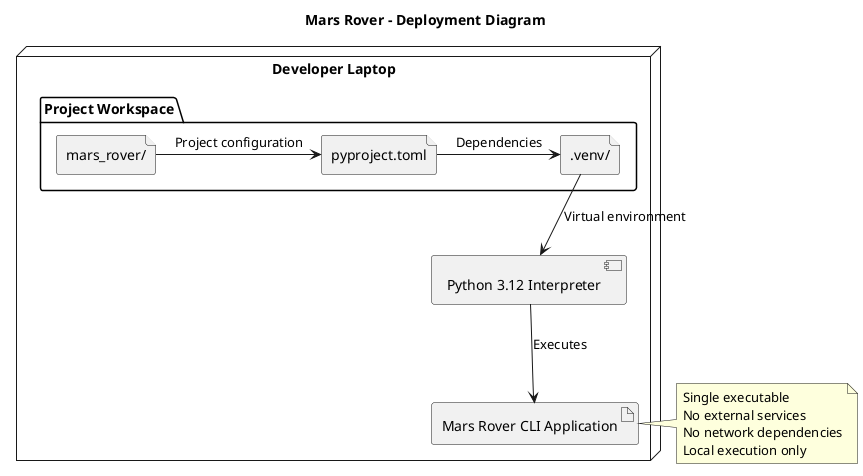

# 7. Deployment View

## 7.1 Overview

The Mars Rover system has a **trivial local deployment**: a single Python 3.12 CLI application running on a developer's laptop. No servers, containers, or external infrastructure are required.

## 7.2 Deployment Diagram



*Diagram file: [./diagrams/deployment.puml](./diagrams/deployment.puml)*

## 7.3 Deployment Environment

### 7.3.1 Hardware Requirements
- **Any modern laptop** with Python 3.12 support
- **No specialized hardware** (CPU, RAM, storage are negligible)
- **No GPU or accelerators** required

### 7.3.2 Software Requirements
- **Python 3.12** interpreter
- **Standard Python libraries** only (no external dependencies for core functionality)
- **Optional development tools**: pytest, ruff, black, isort

## 7.4 Deployment Process

### 7.4.1 Setup Steps
1. **Clone repository** to local workspace
2. **Create virtual environment**: `python -m venv .venv`
3. **Install dependencies**: `pip install -e ".[dev]"`
4. **Verify installation**: `mars_rover --help`

### 7.4.2 Execution
```bash
# Run from project directory
python mars_rover/cli/main.py --commands "LMLMLMLMM" --position "1 2 N" --grid "5 5"
```

## 7.5 Operational Considerations

### 7.5.1 No Operational Infrastructure
- **No servers** to provision or maintain
- **No databases** to backup or scale
- **No network endpoints** to secure or monitor
- **No containers** to build or orchestrate

### 7.5.2 Development-Only Nature
- **Single-user access** via local CLI
- **Transient state** lost on program exit
- **No persistence** between invocations
- **No concurrency** or parallel execution

## 7.6 Consistency with Architecture

The local-only deployment aligns with architectural constraints:
- **Python 3.12 constraint**: Satisfied by local interpreter
- **In-memory state**: No persistence mechanisms needed
- **CLI interface**: Direct command-line execution
- **Minimal dependencies**: Standard library only

## 7.7 Summary

The Mars Rover system deploys as a single Python executable on a developer's laptop. This matches the kata's educational purpose and keeps the architecture simple, testable, and maintainable without operational overhead.

---

*Next: Chapter 8 will cover cross-cutting concepts.*
